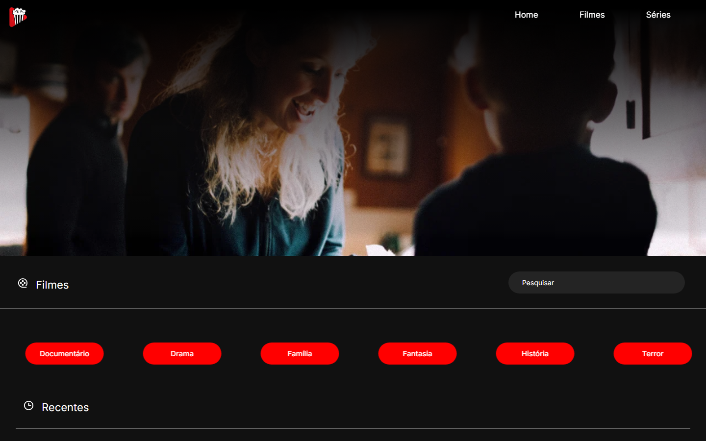
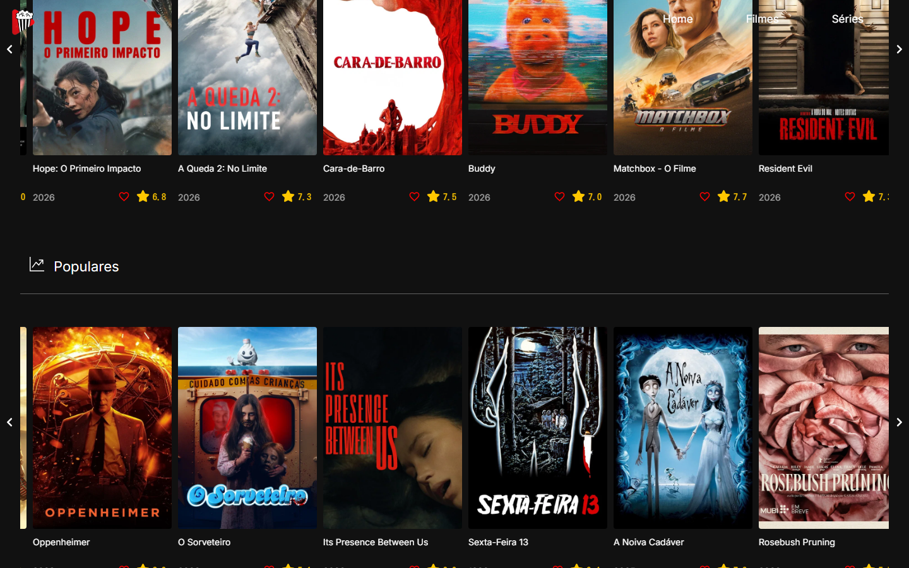
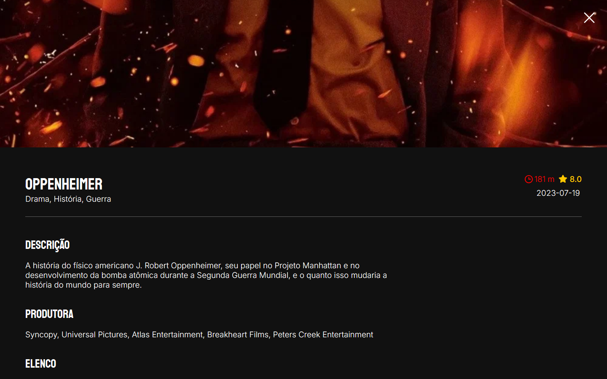

# StarFlicks

[](https://github.com/Plovatto/StarFlicks/actions/workflows/deploy.yml)
[](LICENSE)

Catálogo de filmes e séries feito com React, consumindo a API do TMDB para exibir lançamentos, populares, gêneros, busca e detalhes de cada título com trailer e elenco.

**Acesse o app:** https://plovatto.github.io/StarFlicks/

> **Projeto de estudo (2023):** meu primeiro projeto com React, mantido aqui para mostrar minha evolução como desenvolvedora.

<p align="center">
  
</p>

<p align="center"><em>Página inicial com banner aleatório, busca e filtros por gênero</em></p>

<table>
  <tr>
    <td width="50%"></td>
    <td width="50%"></td>
  </tr>
  <tr>
    <td align="center"><em>Carrosséis de recentes e populares</em></td>
    <td align="center"><em>Detalhes do título com sinopse, produtora e elenco</em></td>
  </tr>
</table>

## Funcionalidades

- Banner com imagens aleatórias de filmes populares
- Alternância entre filmes e séries
- Filtro por gênero
- Busca por título
- Carrosséis de lançamentos recentes e títulos populares
- Página de detalhes com gêneros, duração, nota, sinopse, produtora, elenco e trailer do YouTube
- Lista de favoritos salva no navegador (localStorage)
- Conteúdo em português a partir da API do TMDB
- Deploy automatizado com GitHub Actions e GitHub Pages

## Tecnologias

- [React](https://react.dev/) 18
- [Create React App](https://create-react-app.dev/)
- [React Router](https://reactrouter.com/) 6
- [styled-components](https://styled-components.com/)
- [React Slick](https://react-slick.neostack.com/) - carrosséis
- [React YouTube](https://github.com/tjallingt/react-youtube) - trailers
- [React Icons](https://react-icons.github.io/react-icons/)
- [API do TMDB](https://developer.themoviedb.org/) - dados de filmes e séries
- GitHub Actions - deploy automatizado
- GitHub Pages - hospedagem

## Como Executar

### Pré-requisitos

Antes de começar, tenha instalado:

- [Node.js](https://nodejs.org/)
- npm

Também é necessária uma chave de API do TMDB, gerada gratuitamente em [themoviedb.org](https://www.themoviedb.org/settings/api).

### Instalação

Clone o repositório:

```bash
git clone https://github.com/Plovatto/StarFlicks.git
```

Acesse a pasta do projeto:

```bash
cd StarFlicks
```

Instale as dependências:

```bash
npm install
```

Crie o arquivo de variáveis de ambiente:

```bash
cp .env.example .env
```

Preencha a chave do TMDB em `.env` e execute:

```bash
npm start
```

O projeto estará disponível em:

```text
http://localhost:3000/StarFlicks
```

## Variáveis de Ambiente

As variáveis são definidas no arquivo `.env`, que não deve ser versionado.

Utilize `.env.example` como referência:

```env
REACT_APP_KEY=
```

## Deploy

O deploy é feito no GitHub Pages pelo workflow `.github/workflows/deploy.yml`, disparado a cada push na branch `main`.

Duas configurações são necessárias no repositório:

- Em **Settings → Pages**, a origem deve estar como **GitHub Actions**.
- Em **Settings → Secrets and variables → Actions**, o secret `REACT_APP_KEY` deve conter a chave do TMDB. O Create React App embute a variável no build, então ela precisa existir no ambiente da Action.

O campo `homepage` do `package.json` define o caminho `/StarFlicks` usado nos assets e nas rotas. Como o GitHub Pages não tem suporte nativo a rotas de SPA, o workflow copia o `index.html` para `404.html`, permitindo abrir diretamente páginas como `/StarFlicks/movie/872585`.

## Scripts

| Comando         | Descrição                                 |
| --------------- | ----------------------------------------- |
| `npm start`     | Inicia o servidor de desenvolvimento      |
| `npm run build` | Gera o build de produção na pasta `build` |
| `npm test`      | Executa os testes                         |

## Estrutura do Projeto

```text
src/
├── pages/
│   ├── components/
│   │   ├── Category.jsx               # Filtro por gênero
│   │   ├── FavoriteMovies.jsx         # Lista de favoritos
│   │   ├── GenreCarousel.jsx          # Carrossel de títulos por gênero
│   │   ├── MediaCards.jsx             # Cards de filmes e séries
│   │   ├── MovieDetails.jsx           # Página de detalhes do filme
│   │   ├── PopularMoviesCarousel.jsx  # Carrossel de populares
│   │   ├── RandomImageCarousel.jsx    # Banner com imagens aleatórias
│   │   ├── RecentMoviesCarousel.jsx   # Carrossel de lançamentos
│   │   ├── Search.jsx                 # Campo de busca
│   │   ├── SeriesDetails.jsx          # Página de detalhes da série
│   │   └── style.js                   # Componentes estilizados
│   └── index.jsx                      # Página inicial
├── App.jsx                            # Rotas da aplicação
├── global.css
└── index.js
```

## Licença

Distribuído sob a [Licença MIT](LICENSE).

Este produto usa a API do TMDB, mas não é endossado nem certificado pelo TMDB.
